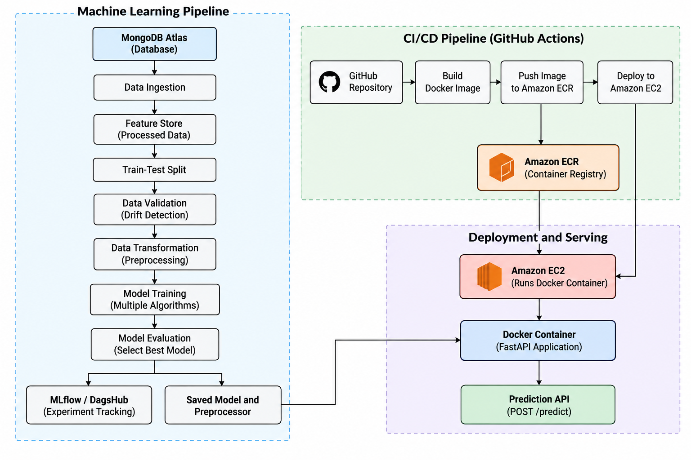

# NetworkSecurity — End-to-End Machine Learning Project

An end-to-end machine learning application for **phishing website detection**, built with Python and Scikit-learn and deployed using Docker, Amazon ECR, Amazon EC2, and GitHub Actions CI/CD.

The project demonstrates the complete ML lifecycle, from data ingestion and validation to model training, prediction, containerization, and cloud deployment.

## Table of Contents

- [Overview](#overview)
- [Project Objectives](#project-objectives)
- [System Architecture](#system-architecture)
- [Tech Stack](#tech-stack)
- [Project Structure](#project-structure)
- [Machine Learning Pipeline](#machine-learning-pipeline)
- [Model Training and Evaluation](#model-training-and-evaluation)
- [Model Prediction API](#model-prediction-api)
- [Docker Containerization](#docker-containerization)
- [CI/CD Pipeline](#cicd-pipeline)
- [AWS Deployment](#aws-deployment)
- [Local Setup and Execution](#local-setup-and-execution)
- [Configuration and Environment Variables](#configuration-and-environment-variables)
- [Security Considerations](#security-considerations)
- [Challenges and Learnings](#challenges-and-learnings)
- [Future Improvements](#future-improvements)
- [Author](#author)

---

## Overview

Phishing websites imitate legitimate websites to deceive users into sharing sensitive information or interacting with malicious content. Detecting potentially malicious websites using their characteristics is an important application of machine learning in cybersecurity.

**NetworkSecurity** is a machine learning project that uses website-related features to classify input records using a trained classification model.

The project goes beyond training a model in a notebook. It implements a modular ML pipeline, separates preprocessing from model inference, exposes predictions through a FastAPI application, packages the application into a Docker image, and automates deployment through a GitHub Actions workflow.

The application accepts a CSV file containing website feature records and returns predictions through an API endpoint.

## Project Objectives

- Build a reusable, modular machine learning pipeline.
- Ingest structured data from MongoDB Atlas.
- Validate data and identify potential distribution drift.
- Apply preprocessing and feature transformation consistently.
- Train and evaluate multiple classification algorithms.
- Track model evaluation metrics using MLflow and DagsHub where configured.
- Save the trained model and preprocessing object for inference.
- Expose prediction functionality through a FastAPI application.
- Containerize the application using Docker.
- Store Docker images in Amazon Elastic Container Registry (ECR).
- Automate build and deployment workflows using GitHub Actions.
- Deploy the application on an Amazon EC2 instance.

## System Architecture



### Architecture overview

- **Data ingestion:** Retrieves data from MongoDB Atlas and prepares the dataset.
- **Data validation:** Checks data quality and detects potential distribution drift.
- **Data transformation:** Applies the fitted preprocessing pipeline.
- **Model training:** Trains and evaluates classification algorithms.
- **Experiment tracking:** Records model metrics through MLflow and DagsHub, where configured.
- **API:** Uses FastAPI to accept CSV uploads and return predictions.
- **Containerization:** Docker packages the application and its dependencies.
- **Image registry:** Amazon ECR stores the built Docker image.
- **Deployment:** Amazon EC2 runs the container, while GitHub Actions automates the deployment workflow.
## Tech Stack

| Category | Technologies |
|---|---|
| Programming language | Python |
| Data manipulation | Pandas, NumPy |
| Machine learning | Scikit-learn |
| Data storage | MongoDB Atlas |
| Experiment tracking | MLflow, DagsHub |
| API development | FastAPI |
| API server | Uvicorn |
| Data validation | Statistical distribution testing, including the two-sample Kolmogorov–Smirnov test |
| Model serialization | Pickle-based artifact loading and saving |
| Containerization | Docker |
| Container registry | Amazon Elastic Container Registry (ECR) |
| Cloud deployment | Amazon EC2 |
| CI/CD automation | GitHub Actions |
| Version control | Git and GitHub |

## Project Structure

The repository is organized into separate modules for the machine learning pipeline, utilities, deployment, and supporting files.

```text
NetworkSecurity/
│
├── .github/
│   └── workflows/
│       └── main.yaml
│
├── data_schema/
│
├── final_model/
│   ├── model.pkl
│   └── preprocessor.pkl
│
├── logs/
├── Network_data/
├── networksecurity/
│   ├── components/
│   ├── constants/
│   ├── entity/
│   ├── exception/
│   ├── logging/
│   ├── pipeline/
│   └── utils/
│
├── notebooks/
├── prediction_data/
├── templates/
├── valid_data/
│
├── app.py
├── main.py
├── push_data.py
├── test_mongodb.py
├── Dockerfile
├── requirements.txt
├── setup.py
├── README.md
└── .gitignore
```

*Note: This tree summarizes the project structure. Individual module filenames and generated artifacts may vary as the project evolves.*

### Important directories and files

- **`networksecurity/components/`** — contains the modular components used for ingestion, validation, transformation, and model training.
- **`networksecurity/pipeline/`** — coordinates the machine learning training workflow.
- **`networksecurity/utils/`** — contains reusable utility functions for data handling and artifact management.
- **`final_model/`** — stores the serialized model and preprocessing artifacts used for prediction.
- **`templates/`** — contains HTML templates used to render prediction results.
- **`app.py`** — defines the FastAPI application and its API endpoints.
- **`main.py`** — serves as an entry point for executing the training pipeline.
- **`push_data.py`** — supports uploading dataset records to MongoDB Atlas.
- **`Dockerfile`** — defines how the application image is built.
- **`.github/workflows/main.yaml`** — defines the automated integration, image publishing, and deployment workflow.
- **`requirements.txt`** — lists Python dependencies.
- **`setup.py`** — configures the Python package.

## Machine Learning Pipeline

### 1. Data Ingestion

Data is retrieved from a MongoDB Atlas database and converted into a Pandas DataFrame.

The ingestion component:

- Connects to the configured MongoDB database and collection.
- Retrieves the available records.
- Removes MongoDB's internal `_id` field when present.
- Replaces designated missing-value markers with appropriate missing values.
- Saves the ingested data to a feature-store CSV file.
- Splits the dataset into training and testing sets.
- Saves the resulting datasets as separate CSV files.

The ingestion process returns a data-ingestion artifact containing the generated training and testing file paths.

### 2. Data Validation

Data validation checks whether the data is suitable for the next stages of the pipeline.

The project includes dataset drift detection using the two-sample Kolmogorov–Smirnov (KS) test.

For each applicable feature, the test compares the distributions in the reference and comparison datasets.

- A p-value below the configured significance threshold indicates evidence of a distribution difference.
- A p-value at or above the threshold indicates insufficient evidence to reject the null hypothesis of equal distributions.

The results are recorded in a drift report so that potential differences can be inspected.

**Important:** A high p-value does not prove that two distributions are identical. Also, a KS test applied to encoded categorical features should be interpreted carefully; a categorical-specific test may be more appropriate for those columns.

### 3. Data Transformation

The transformation component prepares the data for machine learning.

Depending on the feature types and configured preprocessing pipeline, this stage can include:

- Handling missing values.
- Encoding categorical variables.
- Scaling numerical features.
- Separating input features from the target column.
- Saving the fitted preprocessing object.
- Producing transformed training and testing datasets.

The preprocessor is fitted on the training data and then applied to the testing data using the learned transformations. This prevents the test dataset from influencing the fitted preprocessing parameters.

The saved preprocessor is reused during inference so that incoming data receives the same transformations used during training.

### 4. Model Training

The model-training component evaluates multiple classification algorithms using the configured model and hyperparameter search space.

Models explored in the project include:

- Random Forest
- Decision Tree
- Gradient Boosting
- Logistic Regression
- AdaBoost

The selected model is evaluated using classification metrics, and the trained model is serialized for later inference.

### 5. Artifact Management

The pipeline saves the trained model and preprocessing object as reusable artifacts.

These artifacts allow the prediction application to load the previously trained model rather than retraining it every time the API starts.

The model and preprocessor must remain compatible with each other and with the versions of the libraries used to create them.

## Model Training and Evaluation

The project evaluates classification models using metrics such as:

- **Precision:** The proportion of predicted positive cases that are actually positive.
- **Recall:** The proportion of actual positive cases correctly identified by the model.
- **F1-score:** The harmonic mean of precision and recall.

The metrics help compare model performance beyond accuracy alone, which is important when false positives and false negatives have different implications.

The project integrates MLflow and DagsHub for experiment tracking. Where tracking is configured, the training workflow can record evaluation metrics and model-related information.

Actual model performance depends on the dataset, preprocessing configuration, training procedure, and selected hyperparameters. Report measured evaluation results here if you want to publish numerical performance claims.

## Model Prediction API

The FastAPI application exposes endpoints for training and prediction.

### API endpoints

| Method | Endpoint | Purpose |
|---|---|---|
| GET | `/` | Redirects to the API documentation |
| GET | `/docs` | Provides interactive Swagger UI documentation |
| GET | `/train` | Initiates the training pipeline |
| POST | `/predict` | Accepts a CSV file and returns predictions |

### Prediction workflow

1. A user uploads a CSV file containing the expected feature columns.
2. FastAPI reads the uploaded file into a Pandas DataFrame.
3. The application loads the saved preprocessing object and trained model.
4. The `NetworkModel` wrapper applies preprocessing and generates predictions.
5. Predictions are added to the DataFrame in a column named `predicted_column`.
6. The application renders the resulting table using an HTML template.

### Testing the API

After deployment, open:

**API documentation:** `http://<EC2-PUBLIC-IP>:8080/docs`

In the Swagger UI:

1. Expand the `POST /predict` endpoint.
2. Click **Try it out**.
3. Upload a CSV file containing the expected input features.
4. Click **Execute**.
5. Inspect the returned prediction results.

The uploaded CSV must contain the required feature columns in a format compatible with the trained preprocessor. The prediction label interpretation should follow the target encoding used during training.

## Docker Containerization

Docker packages the application and its Python dependencies into a portable image.

The `Dockerfile` defines the base Python image, working directory, application files, dependency installation, and startup command.

Containerization provides a consistent runtime environment across development and deployment.

The deployment configuration maps port `8080` on the EC2 host to port `8000` inside the container, assuming the application listens on port `8000`.

The application must bind to `0.0.0.0` inside the container to accept connections through the published Docker port.

Example port mapping:

```bash
docker run -d \
  --restart unless-stopped \
  -p 8080:8000 \
  --name networksecurity \
  <IMAGE_URI>
```

Replace `<IMAGE_URI>` with the full image URI in Amazon ECR.

## CI/CD Pipeline

The project uses GitHub Actions to automate the process of building, publishing, and deploying the application.

The workflow is defined in:

```text
.github/workflows/main.yaml
```

The workflow contains three major stages.

### 1. Continuous Integration

The integration job checks out the repository and runs the configured validation steps.

The current workflow includes placeholder commands for linting and unit testing. These should be replaced with actual linting and test commands as the test suite grows.

### 2. Continuous Delivery

The delivery job:

1. Checks out the repository.
2. Installs required command-line utilities.
3. Configures AWS credentials using GitHub Secrets.
4. Authenticates with Amazon ECR.
5. Builds the Docker image.
6. Tags the image.
7. Pushes the image to the configured ECR repository.

The image is then available in Amazon ECR for deployment.

### 3. Continuous Deployment

The deployment job runs on the configured self-hosted GitHub Actions runner on EC2.

It:

1. Waits for the image-publishing job to succeed.
2. Checks out the repository.
3. Configures AWS credentials.
4. Authenticates with Amazon ECR.
5. Pulls the latest image.
6. Starts the Docker container with the configured port mapping.
7. Cleans up unused Docker resources.

The successful workflow provides an automated path from a code change pushed to GitHub to a newly deployed application image.

**Runner requirement:** The self-hosted runner must be online, correctly configured, and have sufficient disk space to execute deployment jobs.

## AWS Deployment

The project uses the following AWS services:

### Amazon EC2

EC2 hosts the Docker container running the FastAPI application.

The instance must have:

- A compatible operating system and Docker installation.
- Sufficient disk space and memory.
- Network access to Amazon ECR.
- An active GitHub Actions self-hosted runner when required by the workflow.
- A security group that permits inbound traffic on the application port.

### Amazon Elastic Container Registry (ECR)

ECR stores the Docker image produced by the GitHub Actions workflow.

The deployment job authenticates to the registry and pulls the image onto the EC2 instance.

### AWS Security Groups

The EC2 security group must allow inbound traffic to the application port.

For this configuration, port `8080` is used. In a production environment, restrict access where possible and consider placing the application behind HTTPS-enabled infrastructure instead of exposing the application port publicly.

### Deployment verification

After deployment, verify the running container:

```bash
docker ps
```

Inspect application logs if startup fails:

```bash
docker logs --tail 100 networksecurity
```

Check disk capacity:

```bash
df -h
```

Test the application locally on the instance:

```bash
curl -I http://127.0.0.1:8080/docs
```

Then access the API documentation using the EC2 public IP address and port `8080`.

## Local Setup and Execution

### Prerequisites

Install or configure the following:

- Python version compatible with the project's dependencies.
- Git.
- Docker, if testing the container locally.
- Access to the configured MongoDB Atlas database, if running data ingestion.
- Environment variables required by the selected pipeline components.

### 1. Clone the repository

```bash
git clone https://github.com/Animessshh/NetworkSecurity.git
cd NetworkSecurity
```

### 2. Create a virtual environment

On Linux or macOS:

```bash
python3 -m venv venv
source venv/bin/activate
```

On Windows PowerShell:

```powershell
python -m venv venv
.\venv\Scripts\Activate.ps1
```

### 3. Install dependencies

```bash
python -m pip install --upgrade pip
pip install -r requirements.txt
```

### 4. Configure environment variables

Create a local `.env` file in the project root and provide the configuration required by the pipeline.

Do not commit this file to GitHub.

### 5. Run the training pipeline

From the project root:

```bash
python main.py
```

This runs the training workflow as implemented in `main.py`, including the configured ingestion, validation, transformation, and model-training stages.

The pipeline requires access to its configured data source and any services used by the selected training and experiment-tracking components.

### 6. Start the API locally

If the project uses the `app:app` FastAPI application object, run:

```bash
uvicorn app:app --host 0.0.0.0 --port 8000
```

Alternatively, use the application's existing startup command if it is configured differently.

Open the documentation at:

`http://127.0.0.1:8000/docs`

If the saved model and preprocessor are available, test the `/predict` endpoint using a compatible CSV file.

## Configuration and Environment Variables

The project uses environment variables to keep credentials and deployment settings outside the source code.

Depending on which components are enabled, configuration may include:

| Variable | Purpose |
|---|---|
| `MONGODB_URL_KEY` or the project's configured MongoDB URL variable | MongoDB Atlas connection string |
| `AWS_ACCESS_KEY_ID` | AWS access key used by the configured deployment workflow |
| `AWS_SECRET_ACCESS_KEY` | Corresponding AWS secret access key |
| `AWS_REGION` | AWS region, configured as `us-east-1` for this deployment |
| `AWS_ECR_LOGIN_URI` | Amazon ECR registry URI |
| `ECR_REPOSITORY_NAME` | ECR repository containing the Docker image |
| `DAGSHUB_TOKEN` | DagsHub authentication token, if used by the tracking configuration |

**Important:** Use the exact environment variable names expected by your current source code and workflow. The MongoDB variable, for example, must match the name used in the ingestion and database utility modules.

Store deployment credentials in GitHub Actions Secrets or an appropriate secret-management service. Never commit actual credentials or tokens to the repository.

## Security Considerations

- Never publish `.env` files, AWS credentials, MongoDB connection strings, or DagsHub tokens.
- Keep `.env`, virtual environments, local databases, logs, and unnecessary generated files out of version control.
- Restrict AWS IAM permissions to the actions the deployment workflow actually needs.
- Restrict SSH access to known IP addresses instead of allowing SSH from the entire internet.
- Avoid exposing development endpoints, such as `/train`, to unrestricted public access.
- Use HTTPS and appropriate authentication when exposing an application beyond a demonstration environment.
- Load serialized model artifacts only from trusted sources, as pickle-based serialization can execute code during deserialization.
- Rotate credentials immediately if they are accidentally exposed.

## Challenges and Learnings

Developing and deploying this project involved working through several practical engineering challenges.

### Modular ML pipeline design

Organizing ingestion, validation, transformation, and training into separate components helped establish clearer responsibilities and a more maintainable project structure.

### Data quality and drift detection

Implementing distribution checks provided experience with statistical hypothesis testing and the importance of monitoring differences between datasets.

### Consistent preprocessing

Saving the preprocessing object alongside the model helped ensure that prediction inputs are transformed consistently with training data.

### Experiment tracking and authentication

Integrating MLflow and DagsHub introduced the challenges of configuring remote experiment tracking and ensuring that authentication works in automated environments.

### Docker and cloud deployment

Containerizing the application and publishing images to ECR provided hands-on experience with image creation, registry authentication, port mapping, and running applications on EC2.

### CI/CD automation

GitHub Actions automated the build-and-deploy process and demonstrated how source-control events can trigger a sequence of deployment jobs.

### Production troubleshooting

Debugging container startup failures, missing Python dependencies, DagsHub authentication prompts, and disk-space exhaustion provided practical experience in diagnosing application and infrastructure issues.

## Future Improvements

Potential improvements include:

- Add comprehensive unit and integration tests to the CI pipeline.
- Replace placeholder linting and test steps with actual tools and commands.
- Evaluate models using cross-validation and keep the test set separate from model selection.
- Add structured application logging and centralized log collection.
- Add API request validation and clearer error responses.
- Protect the training endpoint with authentication or remove it from the public deployment.
- Use IAM roles or temporary credentials where appropriate instead of long-lived AWS access keys.
- Add HTTPS through a reverse proxy, load balancer, or managed certificate configuration.
- Introduce health checks and container restart monitoring.
- Add model-version tracking and a reproducible model promotion process.
- Monitor production prediction distributions and model performance over time.
- Expand automated tests to cover preprocessing, prediction behavior, and invalid CSV uploads.

## Author

**Animesh Sharma**

B.Tech — Computer Science Engineering

Project: NetworkSecurity — End-to-End Machine Learning and Cloud Deployment

GitHub: [Animessshh](https://github.com/Animessshh)

---

*This project was developed as a practical demonstration of an end-to-end machine learning workflow, including data engineering, model development, API integration, containerization, and automated cloud deployment.*
 
